<div align="center">


# Tunisie Telecom E-Shop

**A full-stack online store for a telecom operator: browse, buy and manage, end to end.**

Built as an internship project in **July 2023** by [Karim Feki](https://github.com/fekikarim) and [Nesrine Derouiche](https://github.com/nesrine-derouiche), and rebuilt into a complete, production-style codebase to master every layer of a modern web stack.

[](https://react.dev)
[](https://vite.dev)
[](https://tailwindcss.com)
[](https://expressjs.com)
[](https://nodejs.org)
[](https://sqlite.org)
[](LICENSE)

[Features](#-features) · [Screenshots](#-screenshots) · [Architecture](#-architecture) · [Quick start](#-quick-start) · [API](#-api-reference) · [Team](#-team)

</div>

> **Demonstration project.** This is not an official Tunisie Telecom service. Payments are simulated and no real transaction is processed.

---

## ✨ Overview

The platform covers the full purchasing journey and the back office that runs it:

- **Customers** browse a catalogue, filter and search products, manage a cart, check out, and follow their orders.
- **Administrators** monitor sales on a dashboard, manage products (price, stock, category, image) and move orders through their lifecycle.

Both workflows share one API and one database, so an admin change is visible to customers immediately.

## 🚀 Features

<table>
<tr>
<td width="50%" valign="top">

### 🛍️ Storefront
- Modern home page with hero, categories, promotional banners, featured and popular products
- Shop with category chips, **search**, **sorting** (newest, price, name) and live stock badges
- Product pages with stock status, quantity selector and related products
- Cart with quantity controls, removal, subtotal and a free-delivery progress hint
- Checkout with validated delivery details, **cash on delivery** or **simulated card payment**
- Order confirmation and a **My orders** history with expandable details

</td>
<td width="50%" valign="top">

### 🛠️ Administration
- Dashboard: products, orders, customers, revenue, **7-day revenue chart**, orders by status, low-stock alerts, recent orders
- Product management: create, edit, delete (with confirmation), search and filter, image **upload or URL**
- Order management: filter by status, inspect items and customer details, update status
- Stock safety: cancelling an order **returns its stock** and cancelled orders are final

</td>
</tr>
<tr>
<td width="50%" valign="top">

### 🔐 Security & reliability
- Passwords hashed with **bcrypt**; JWT authentication with role-based access control
- All input validated on the server, with field-level error messages
- Totals, prices and delivery fees calculated **on the server**, never trusted from the client
- Stock updates and order creation run inside **database transactions**

</td>
<td width="50%" valign="top">

### 🎨 Experience
- Responsive layouts for desktop, laptop, tablet and phone
- Loading skeletons, empty states, toasts and accessible dialogs
- Restrained micro-interactions and a brand-driven blue palette
- Dedicated **About** page presenting the team and the stack

</td>
</tr>
</table>

## 📸 Screenshots

<table>
<tr>
<td>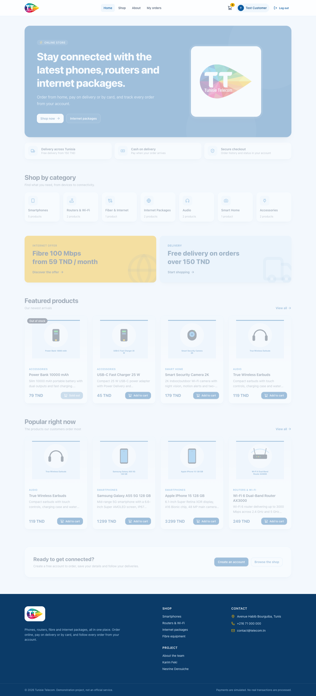<p align="center"><sub><b>Home</b>: hero, categories, promotions and products</sub></p></td>
<td>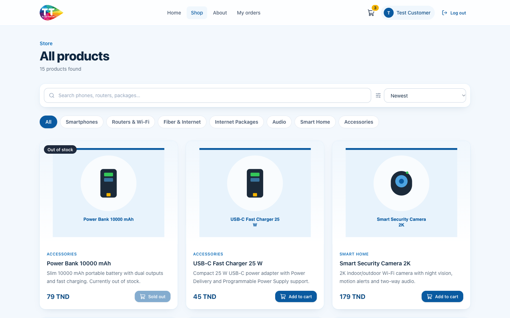<p align="center"><sub><b>Shop</b>: filters, search, sorting and stock badges</sub></p></td>
</tr>
<tr>
<td>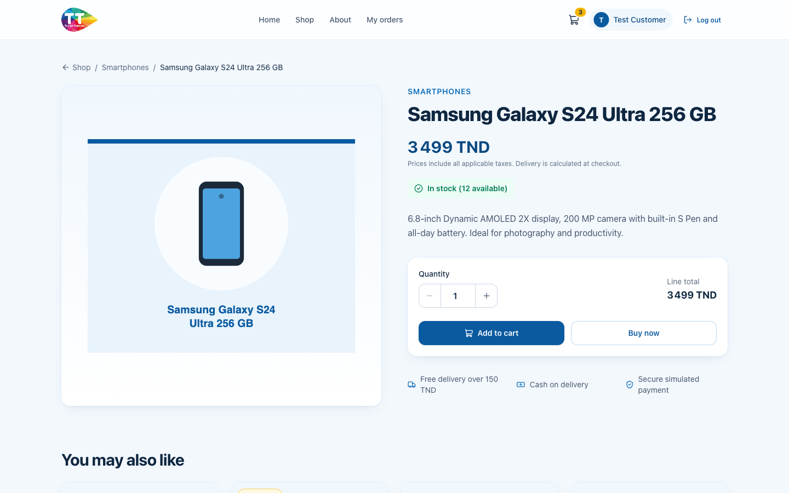<p align="center"><sub><b>Product details</b>: stock status and quantity selector</sub></p></td>
<td>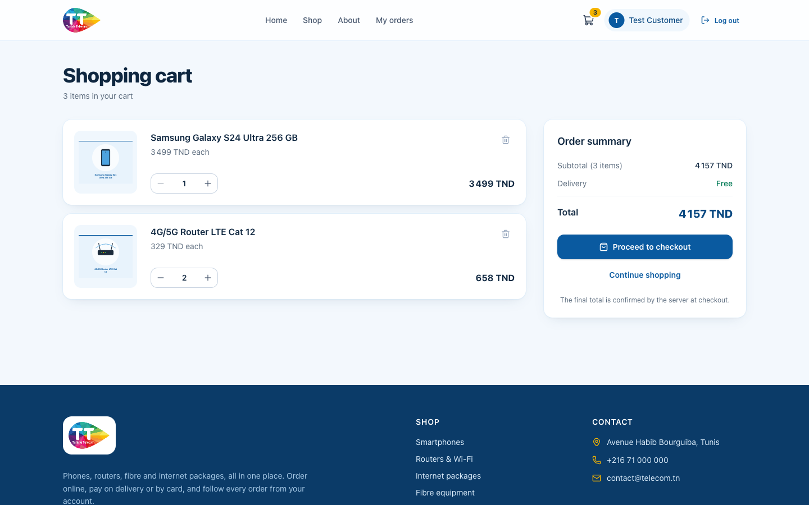<p align="center"><sub><b>Cart</b>: quantities, totals and delivery hint</sub></p></td>
</tr>
<tr>
<td>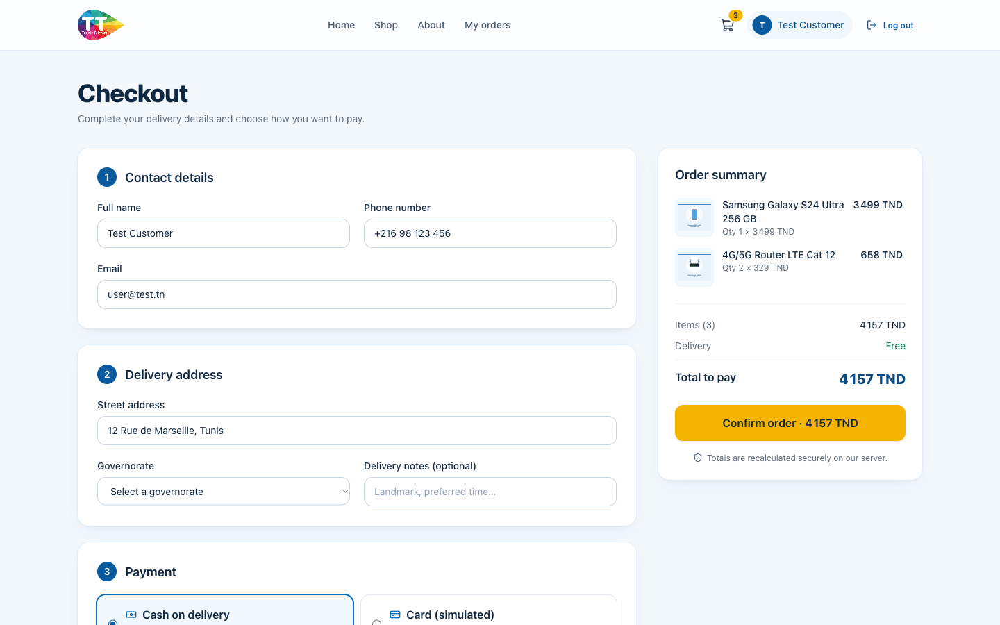<p align="center"><sub><b>Checkout</b>: delivery details and payment choice</sub></p></td>
<td>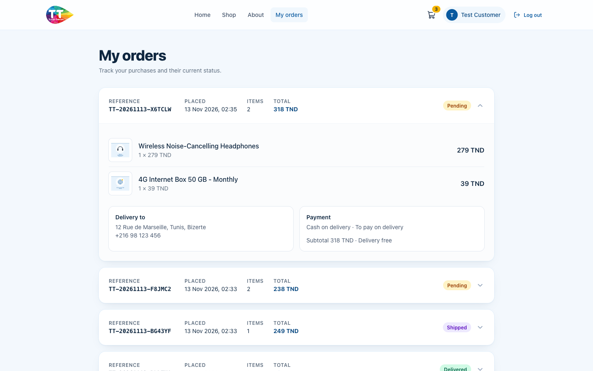<p align="center"><sub><b>My orders</b>: references, status and purchased items</sub></p></td>
</tr>
<tr>
<td colspan="2">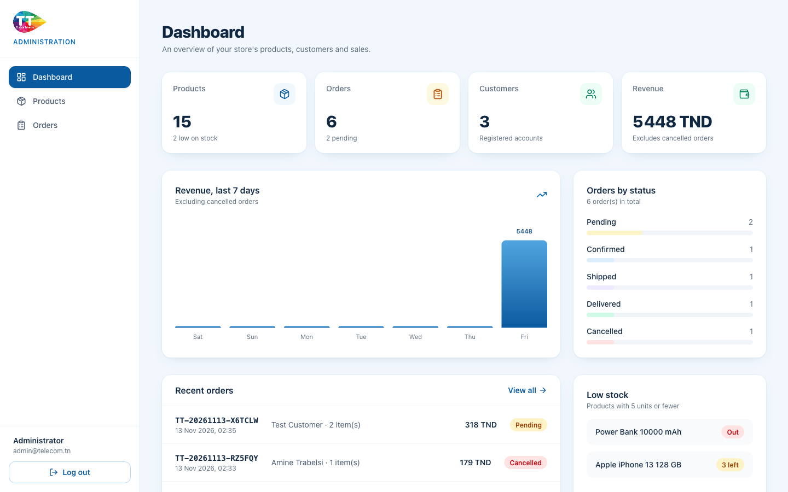<p align="center"><sub><b>Admin dashboard</b>: KPIs, revenue trend, order statuses and low-stock alerts</sub></p></td>
</tr>
<tr>
<td>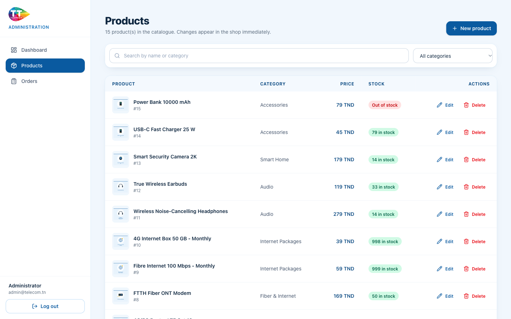<p align="center"><sub><b>Product management</b>: create, edit, delete with confirmation</sub></p></td>
<td>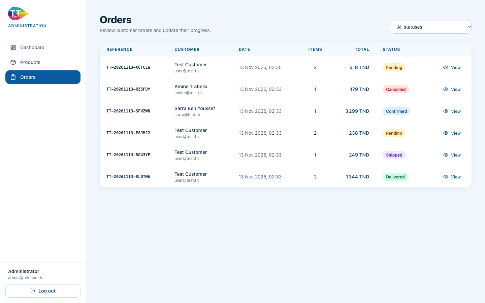<p align="center"><sub><b>Order management</b>: inspect orders and update their status</sub></p></td>
</tr>
<tr>
<td>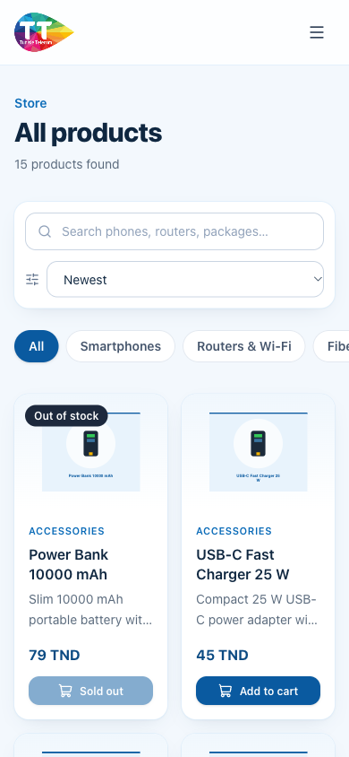<p align="center"><sub><b>Mobile</b>: responsive shop on a phone</sub></p></td>
<td>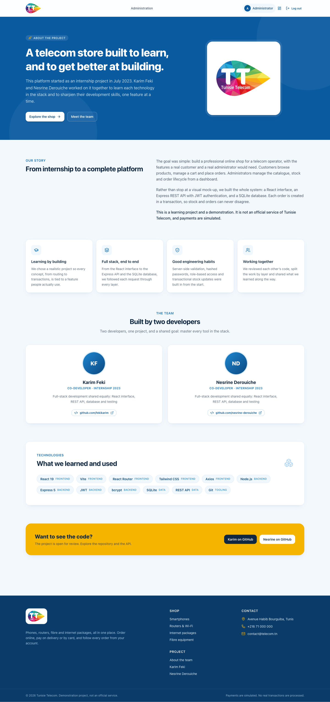<p align="center"><sub><b>About</b>: the story, the team and the stack</sub></p></td>
</tr>
</table>

## 🧭 Architecture

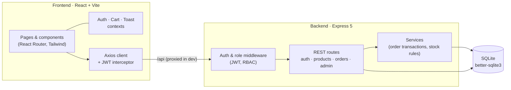

**Design choices**

- **Separation of concerns:** the frontend only renders and collects input; every rule (prices, totals, stock, permissions) lives in the backend.
- **Atomic orders:** creating an order validates stock, decrements it and inserts the order and its items in one transaction, so a failure leaves no partial data.
- **Price snapshots:** order lines store the product name and unit price at purchase time, so history stays correct when the catalogue changes.
- **Money as integers:** prices are stored in millimes (1/1000 TND) to avoid floating-point rounding.

## 🧰 Tech stack

| Layer | Technologies |
|---|---|
| **Frontend** | React 19 · Vite 8 · React Router 7 · Tailwind CSS 4 · Axios · Lucide React |
| **Backend** | Node.js 22+ · Express 5 · JSON Web Tokens · bcrypt (`bcryptjs`) · Multer |
| **Database** | SQLite 3 via `better-sqlite3` (WAL mode, foreign keys, CHECK constraints) |
| **Testing** | Node's built-in test runner against the live HTTP API |
| **Tooling** | npm scripts · concurrently · Git |

## 📁 Project structure

```text
tunisie-telecom-eshop/
├── assets/                      # Official logo (source asset)
├── docs/screenshots/            # Screenshots used in this README
├── backend/
│   ├── src/
│   │   ├── server.js            # Entry point: open DB, seed if empty, start Express
│   │   ├── app.js               # Express app and route wiring
│   │   ├── config.js            # Environment configuration
│   │   ├── db.js                # SQLite connection and schema
│   │   ├── seed.js              # Demo accounts, catalogue and sample orders
│   │   ├── data/catalog.js      # Demonstration data
│   │   ├── middleware/          # JWT authentication, role checks, error handling
│   │   ├── routes/              # auth · products · categories · orders · admin · uploads
│   │   └── services/orders.js   # Order transactions and status rules
│   ├── test/api.test.js         # End-to-end API acceptance tests
│   └── .env.example
├── frontend/
│   ├── public/                  # Logo, product illustrations, placeholder
│   └── src/
│       ├── pages/               # Storefront pages (home, shop, cart, checkout, about…)
│       ├── admin/               # Admin layout, dashboard, products, orders
│       ├── components/          # Navbar, footer, product card, modal, guards…
│       ├── context/             # Auth, cart and toast state
│       └── utils/               # API client and formatting helpers
├── package.json                 # Root scripts (run both apps together)
└── README.md
```

## ⚡ Quick start

**Requirements:** Node.js **22 or newer** and npm.

```bash
# 1. Install all dependencies (backend, frontend and launcher)
npm run install:all

# 2. Configure the API (set a strong JWT_SECRET)
cp backend/.env.example backend/.env

# 3. Start the API and the web app together
npm run dev
```

| Service | URL |
|---|---|
| Storefront & admin | http://localhost:5173 |
| REST API | http://localhost:4000 |
| Health check | http://localhost:4000/api/health |

The database and demo data are created automatically on first start. Restarting the server never duplicates or overwrites data.

### Running the apps separately

```bash
# Backend
cd backend && npm install && npm run dev

# Frontend (in another terminal)
cd frontend && npm install && npm run dev
```

### Other scripts

| Command | Purpose |
|---|---|
| `npm test` | Run the API acceptance suite on a temporary database |
| `npm run build` | Create the production bundle in `frontend/dist` |

## ⚙️ Configuration

Variables are read from `backend/.env` (see `backend/.env.example`).

| Variable | Default | Description |
|---|---|---|
| `PORT` | `4000` | API port |
| `JWT_SECRET` | *(temporary random value)* | Secret used to sign tokens. **Set it in any real environment.** |
| `JWT_EXPIRES_IN` | `7d` | Token lifetime |
| `DB_PATH` | `./data/telecom.db` | SQLite database file |
| `UPLOAD_DIR` | `./uploads` | Folder for uploaded product images |
| `CORS_ORIGIN` | `http://localhost:5173` | Allowed frontend origin |

To reset the demo data, stop the API, delete `backend/data/telecom.db` (and its `-wal` / `-shm` files), then start it again.

## 🔑 Demo accounts

| Role | Email | Password |
|---|---|---|
| Administrator | `admin@telecom.tn` | `Admin123!` |
| Customer | `user@test.tn` | `User123!` |

Two more demo customers (`sarra@test.tn`, `amine@test.tn`, password `User123!`) and sample orders are included for dashboard statistics.

## 💳 Payments

Payments are **simulated**. Cash on delivery leaves the order unpaid. The card option validates the card number (format and Luhn checksum), name, expiry and CVC, then marks the order as paid. Nothing is stored or charged. Use `4111 1111 1111 1111` as a test number.

## 📡 API reference

All responses are JSON. Errors have the shape `{ "message": "…", "errors": { "field": "…" } }`. Protected routes expect `Authorization: Bearer <token>`.

**Authentication**

| Method | Endpoint | Access | Description |
|---|---|---|---|
| `POST` | `/api/auth/register` | Public | Create a customer account |
| `POST` | `/api/auth/login` | Public | Sign in and receive a token |
| `GET` | `/api/auth/me` | Signed in | Current user |

**Catalogue**

| Method | Endpoint | Access | Description |
|---|---|---|---|
| `GET` | `/api/products` | Public | List products. Query: `category`, `search`, `sort` (`newest`, `price_asc`, `price_desc`, `name`, `popular`), `limit` |
| `GET` | `/api/products/:id` | Public | Product details |
| `POST` | `/api/products` | Admin | Create a product |
| `PUT` | `/api/products/:id` | Admin | Update price, stock, category, image… |
| `DELETE` | `/api/products/:id` | Admin | Delete a product |
| `GET` | `/api/categories` | Public | Categories with product counts |
| `POST` | `/api/uploads/product-image` | Admin | Upload an image (multipart field `image`, max 3 MB) |

**Orders**

| Method | Endpoint | Access | Description |
|---|---|---|---|
| `POST` | `/api/orders` | Customer | Place an order (totals calculated by the server) |
| `GET` | `/api/orders/my-orders` | Signed in | The current customer's orders |
| `GET` | `/api/orders` | Admin | All orders, optional `?status=` |
| `GET` | `/api/orders/:id` | Owner or admin | Order details (others receive `404`) |
| `PUT` | `/api/orders/:id/status` | Admin | Update status: Pending, Confirmed, Shipped, Delivered, Cancelled |

**Dashboard**

| Method | Endpoint | Access | Description |
|---|---|---|---|
| `GET` | `/api/admin/dashboard` | Admin | Totals, revenue trend, status breakdown, recent orders, low stock |

## 🔒 Security notes

- Passwords are hashed with bcrypt, and login errors never reveal whether an email exists.
- Tokens are verified on every request, and the user is reloaded from the database, so role changes apply immediately.
- Every input is validated on the server; the client-side checks are only a convenience.
- Secrets come from environment variables, and `.env` is git-ignored.

This is a learning project. Before any real deployment, add rate limiting, HTTPS, httpOnly cookie sessions and a real payment provider.

## 🗺️ Roadmap

- [ ] Customer order cancellation from "My orders"
- [ ] Password reset by email
- [ ] Pagination for large catalogues
- [ ] Docker setup for one-command deployment
- [ ] Automated UI tests (Playwright)

## 👥 Team

<table>
<tr>
<td align="center" width="50%">
<a href="https://github.com/fekikarim"><b>Karim Feki</b></a><br/>
<sub>Co-developer · Internship, July 2023</sub><br/>
<sub>Full-stack development, shared equally with Nesrine</sub>
</td>
<td align="center" width="50%">
<a href="https://github.com/nesrine-derouiche"><b>Nesrine Derouiche</b></a><br/>
<sub>Co-developer · Internship, July 2023</sub><br/>
<sub>Full-stack development, shared equally with Karim</sub>
</td>
</tr>
</table>

This project was a shared learning journey. We built it together to understand each technology in the stack and to improve our craft, one feature at a time.

## 📄 License

Released under the [MIT License](LICENSE). Copyright © 2023–2026 Karim Feki and Nesrine Derouiche.

---

<div align="center">
<sub>Built with care by <a href="https://github.com/fekikarim">Karim Feki</a> &amp; <a href="https://github.com/nesrine-derouiche">Nesrine Derouiche</a></sub>
</div>
